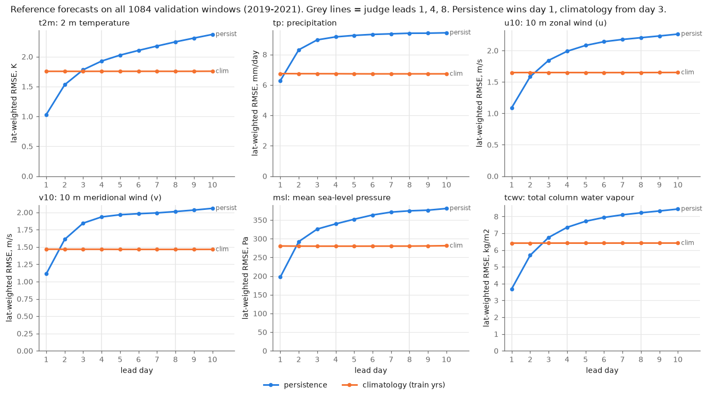

# Devforge-MonsoonVerse

Digital twin of Indian daily weather for **Multiverse of Monsoon (Track 2)**: a model that rolls the
monsoon forward 10 days from 3 input days and responds causally to "what-if" shocks.
The API contract is the organisers' `R1_CONTRACT.md` (kit: https://github.com/OfficialAbhinavSingh/yug-monsoon-kit);
our summary is in [docs/CONTRACT.md](docs/CONTRACT.md). Team progress: [docs/PROGRESS.md](docs/PROGRESS.md).

## Quick start

```bash
python -m venv .venv
# Windows: .venv\Scripts\activate    Linux/macOS: source .venv/bin/activate
pip install -r requirements.txt -r requirements-dev.txt   # Linux: add --extra-index-url https://download.pytorch.org/whl/cpu
pip install git+https://github.com/OfficialAbhinavSingh/yug-monsoon-kit   # organisers' kit (scoring, validator)

python serve.py --port 8000                               # start the server (blocks: run the rest in a 2nd terminal, venv activated)
python tools/validate.py --url http://127.0.0.1:8000      # our pre-check
python -m monsoon_r1.schema_validator http://127.0.0.1:8000   # organisers' validator
python -m pytest -q                                       # all tests
pip install -r dashboard/requirements.txt && streamlit run dashboard/app.py   # dashboard (needs data/ + running server)
```

Use `127.0.0.1`, not `localhost`, on Windows (localhost adds ~2 s per request).

## Training data (never commit it)

Download `india_climate_train.nc` and `stats.json` from the kit's release
https://github.com/OfficialAbhinavSingh/yug-monsoon-kit/releases/tag/v1.0.0 into `data/` (gitignored).
Check them against `SHA256SUMS.txt` from the same release.

## Data and baselines

Daily gridded weather fields over India, 2005–2021, on a 1° 32×36 grid with 6 channels (t2m, tp, u10, v10, msl, tcwv).
We train on 2005–2018 and validate on 2019–2021. Persistence is the better reference at day 1; train-year climatology
is better from day 3 on, for every channel. Details, the baseline table and the figures are in [docs/DATA.md](docs/DATA.md);
the impact maths is in [docs/IMPACT.md](docs/IMPACT.md).



## API

- `POST /health` → `{"status": "ready", "model_name": ..., "backend": "persistence" | "model"}`
- `POST /simulate` with `{"init_states": [3,6,32,36], "doy_sincos": [sin, cos], "steps": 10, "perturbation": null | [6,32,36]}`
  → `{"rollout": [steps,6,32,36], "inference_ms": ...}`. Physical units; channels t2m, tp, u10, v10, msl, tcwv.

## Layout

| Path | What | Owner |
|---|---|---|
| `serve.py` | FastAPI server, contract checks, persistence fallback | Vishwak |
| `twin.py` | `Twin.rollout()`; loads `weights/model.pt` (TorchScript), else persistence | Vishwak |
| `common.py` | Shared constants: channels, grid, shock boxes, validity clamps | Vishwak |
| `eval/score.py` | Judge-identical forecast scoring (uses the kit's `monsoon_r1.scoring`) | Vishwak |
| `eval/shock_test.py` | warm_ocean / monsoon_stall / null shock causality checks | Vishwak |
| `eval/BASELINE.md` | Persistence baseline scores the model must beat | Vishwak |
| `weights/` | Model checkpoint (only Vishwak commits here) | Vishwak |
| `docs/WEIGHTS.md` | How to export the model so the server loads it | Aether → Vishwak |
| `tools/validate.py`, `scripts/` | Pre-checks, repo scan, clean-clone test | Vishwak |
| model + training code | (to come) | Aether |
| `data_tools/` | Data loader (year split, 3-day windows), baselines, README figures | Junaid (built by Vishwak) |
| `impact/` | Crop-stress index per farming region (rain deficit, hot days); dashboard Impact tab | Junaid (built by Vishwak) |
| `dashboard/` | Streamlit app: live maps, shock painter, Shock Lab, ensemble, model card (`streamlit run dashboard/app.py`) | Akash (built by Vishwak) |

## Working rules

One branch per task (`feat/<name>-<task>`), pull request into `main`, reviewed by someone on the other tool.
Never commit data files. `serve.py` may import only torch, numpy, scipy, pandas, xarray, scikit-learn,
lightgbm, onnxruntime, fastapi, flask, uvicorn, gunicorn.
