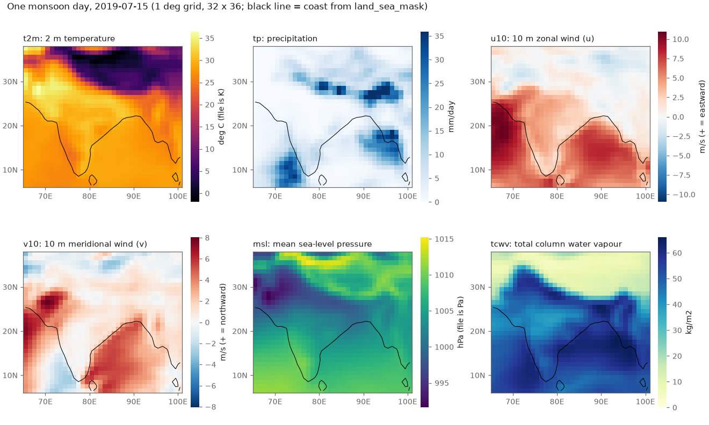
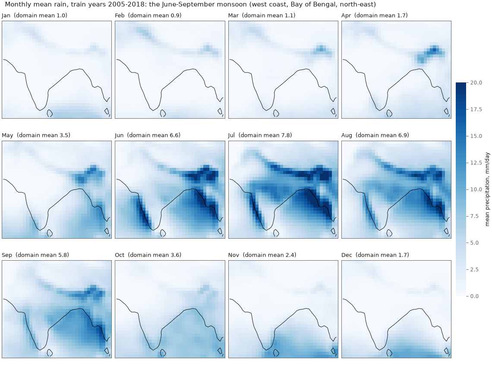
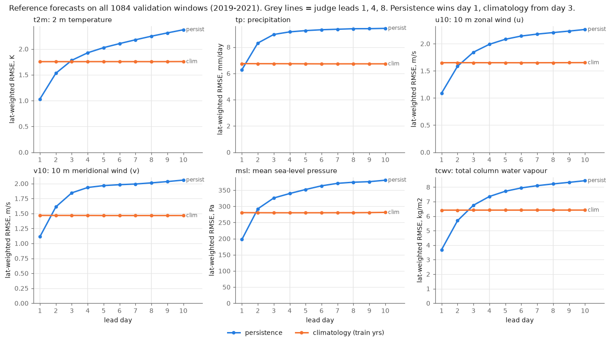

# Data, windows and reference baselines

Code: `data_tools/` (dev and training only; `serve.py` and `twin.py` never import it).

## Dataset: `data/india_climate_train.nc` (organisers' kit, not committed)

| item | value |
|---|---|
| `data` | (time 6209, channel 6, lat 32, lon 36), float32, physical units, no NaN |
| period | daily, 2005-01-01 .. 2021-12-31, no missing days |
| channels (fixed order) | t2m K, tp mm/day, u10 m/s, v10 m/s, msl Pa, tcwv kg/m2 |
| grid | 1 deg cell centres, lat 6.5..37.5 ascending (south to north), lon 65.5..100.5 |
| `static` | `land_sea_mask` (fraction 0..1; the coast is the 0.5 contour), `orography_m` (-0.2..5284 m) |
| ranges | t2m 236..315 K, tp 0..250 mm/day, u10 -16.6..17.8, v10 -17.0..17.7 m/s, msl 97878..105116 Pa, tcwv 0.2..79.5 |

`data/stats.json` (`channels`, `mean`, `std` per channel) matches the **full 2005-2021 archive** exactly (within 0.0004 std).
So it includes the validation years. That makes no practical difference: the train-only mean and std differ by less than 1 % of std.
The judge uses the `stats.json` std to normalise scores. `python -m data_tools.loader --check` prints all of this and exits non-zero on any mismatch.

## Split and windows

- Train 2005-2018 (5113 days), validate 2019-2021 (1096 days). The split is by calendar year (`split_years`).
- A window is 3 consecutive input days ending at day t, plus K target days t+1..t+K. Every input and target day must sit inside one split, and the days must be calendar-contiguous, so no window crosses the train/val boundary.
- `doy_sincos` is `common.doy_sincos(day_of_year(t))` for the **last input day**, with day of year starting at 1 on Jan 1. That is the contract and the judge convention. Target step k is day t+k.
- Window counts: K=1 gives 5110 train / 1093 val windows. K=10 gives 5101 / 1084 (the same 1084 as `eval.score --windows 0`).
- `normalize` / `denormalize` apply the plain `stats.json` z-score. Rain is skewed, so models usually train tp in log1p space. That choice belongs to the model owner and is not built in.

```python
from data_tools.loader import load_archive, load_stats, split_years, normalize, WindowDataset, TorchWindowDataset
arc = load_archive("data/india_climate_train.nc"); st = load_stats("data/stats.json")
tr, va = split_years(arc.dates)
train = WindowDataset(normalize(arc.data, st), arc.dates, tr, k=4)   # (init [3,6,32,36], doy_sincos [2], target [4,6,32,36])
loader_ds = TorchWindowDataset(train)                                  # optional torch wrapper
```

## Reference baselines (`data_tools/baselines.csv`)

- **Persistence** repeats the last input day.
- **Climatology** is the kit's `monsoon_r1.stats.climatology` (per calendar day, 15-day circular smoothing), built from train years only and looked up for the target day.
- Both are scored on all 1084 validation windows for leads 1-10, pooled per lead.
- Columns: plain RMSE, the kit's lat-weighted `rmse_lat` (the judge metric), `best_ref`, and the kit's `csi` for tp at 10 mm/day.

Lat-weighted RMSE, persistence / climatology (the judge's leads):

| lead | t2m K | tp mm/d | u10 m/s | v10 m/s | msl Pa | tcwv kg/m2 | better ref | CSI tp>10 (p / c) |
|---|---|---|---|---|---|---|---|---|
| 1 | 1.03 / 1.76 | 6.28 / 6.75 | 1.09 / 1.65 | 1.11 / 1.47 | 197 / 281 | 3.69 / 6.42 | persistence, all | 0.433 / 0.278 |
| 4 | 1.93 / 1.76 | 9.16 / 6.74 | 1.99 / 1.65 | 1.93 / 1.47 | 340 / 280 | 7.36 / 6.42 | climatology, all | 0.222 / 0.279 |
| 8 | 2.25 / 1.76 | 9.40 / 6.73 | 2.21 / 1.65 | 2.01 / 1.47 | 375 / 280 | 8.22 / 6.42 | climatology, all | 0.201 / 0.279 |

- At lead 2 the result is mixed: persistence is better for t2m, u10 and tcwv, climatology for tp, v10 and msl.
- From lead 3 on, climatology is better for every channel. Persistence keeps losing ground, while climatology stays flat.
- These numbers match `eval/BASELINE.md` (all 1084 windows) to the printed precision.
- `eval/scores.csv` differs slightly: it pools a random sample of 40 windows (seed 0). For example, lead-1 t2m persistence is 1.050 there against 1.031 here. Lead-4 tp climatology is 7.61 against 6.74, and lead-8 msl climatology is 270 against 280.
- The method is the same in both; only the window sample differs. Use the 1084-window numbers as the reference.

## Figures







## Reproduce

```
.venv/Scripts/python -m data_tools.loader --check      # dims, grid, channel order, NaN, ranges vs stats.json (~4 s)
.venv/Scripts/python -m data_tools.baselines           # writes data_tools/baselines.csv (~6 s)
.venv/Scripts/python -m data_tools.plot_fields         # writes docs/img/*.png (needs matplotlib, dev only)
.venv/Scripts/python -m pytest tests/test_data_tools.py -q
```

## Suggested README snippet

```markdown
### Data and baselines
Daily gridded weather fields over India, 2005-2021, on a 1 deg 32x36 grid with 6 channels (t2m, tp, u10, v10, msl, tcwv).
We train on 2005-2018 and validate on 2019-2021. Persistence is the better reference at day 1; train-year climatology
is better from day 3 on, for every channel. Details, the baseline table and the figures are in [docs/DATA.md](docs/DATA.md).


```
